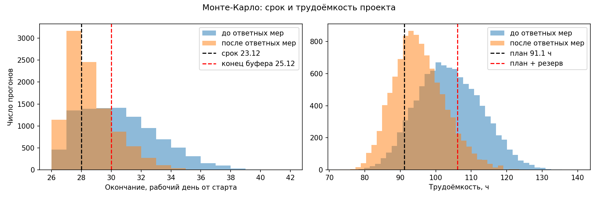

# Реестр рисков

Версия 1.0 · Дата: 15.11.2026 · Владелец реестра: Нияз Бадриев (менеджер проекта ЛР 4)

Реестр — живой документ: обновляется на каждом обзоре спринта. Риски перенесены из устава (R1–R11) и дополнены по итогам ЛР 2–3: проблемами данных, самыми неопределёнными оценками и критическим путём.

## 1. Шкалы

| Балл | Вероятность за проект | Влияние на срок | Влияние на бюджет | Влияние на качество | Влияние на ценность для заказчика |
|---|---|---|---|---|---|
| 1 | до 10% | до 1 дня | до 2 ч | Незаметно заказчику | Незаметно |
| 2 | 10–30% | 1–2 дня | 2–5 ч | Мелкий недочёт в одном результате | Одна второстепенная функция теряет смысл |
| 3 | 30–50% | 3–5 дней, в пределах буфера | 5–10 ч | Заметный недочёт, исправляется в следующем спринте | Заказчик сомневается в части продукта |
| 4 | 50–70% | Больше буфера | 10–15 ч, весь резерв | Ошибочный вывод в отчёте | Заказчик может выбрать другое решение для основной задачи |
| 5 | более 70% | Срыв защиты | Больше резерва | Продукт непригоден для заказчика | Продукт не нужен заказчику |

Оценка риска = вероятность × влияние (берётся максимальное из четырёх влияний).
- 15–25 — высокий: ответная мера сейчас, контроль на каждой синхронизации;
- 8–14 — средний: ответная мера в ближайшем спринте, контроль на обзоре;
- 1–7 — низкий: наблюдаем.

## 2. Матрица рисков

| Вероятность \ Влияние | 1 | 2 | 3 | 4 | 5 |
|---|---|---|---|---|---|
| **5** | | | R10 | | |
| **4** | | | R9 | R1 | |
| **3** | | | R6 | R8, R11 | R2, R4, R7 |
| **2** | | | R3, R5 | | R12 |
| **1** | | | | | |

## 3. Реестр

| № | Категория (RBS) | Причина → событие → последствие | В | Вл | Оценка | Стратегия | Ответная мера | Триггер | Владелец | Резерв | Статус | Issue |
|---|---|---|---|---|---|---|---|---|---|---|---|---|
| R1 | Данные | Из-за неполной разметки OSM часть школ и поликлиник не попадёт на карту, и выводы о доступности будут занижены | 4 | 4 | 16 | Снижение | Выборочная проверка 20–30 объектов по снимкам; при нехватке — дополнение из открытых реестров | Доля найденных объектов ниже 80 % при выборочной проверке | Тимур Зайнуллин | 6 ч | В работе | #119 |
| R2 | Данные | Из-за неточной дорожной сети OSM изохроны будут построены по неверным маршрутам | 3 | 5 | 15 | Снижение | Спайк: проверить пешеходную сеть на 5 контрольных точках перед расчётом по всему городу | Спайк показал расхождение с реальными расстояниями больше 20 % | Тимур Зайнуллин | 4 ч | В работе | #103 |
| R3 | Технологии | Из-за недоступности сервиса расчёта изохрон команда не успеет подготовить карты | 2 | 4 | 8 | Снижение | Запасной вариант расчёта (локальный скрипт на OSMnx), зафиксированный в методике | Сервис недоступен больше дня | Нияз Бадриев | 4 ч | Наблюдаем | #103 |
| R4 | Команда и сроки | Из-за задержки критической работы карта и отчёт не будут готовы к защите | 3 | 5 | 15 | Снижение | Еженедельный контроль буфера и статус-отчёт; перенос US-06 при скорости ниже 8 SP | Задержка критической работы больше 2 дней или израсходовано более половины буфера | Виктория Исаева | буфер 2 дня | В работе | #120 |
| R5 | Данные | Из-за устаревания данных OSM выводы перестанут соответствовать реальности | 2 | 4 | 8 | Снижение | Повторная загрузка данных перед защитой; дата загрузки фиксируется в отчёте | Данные старше 2 месяцев | Тимур Зайнуллин | 2 ч | Наблюдаем | #66 |
| R6 | Требования | Из-за отказа от общественного транспорта часть жителей получит неполную картину доступности | 3 | 3 | 9 | Принятие | Оговорить ограничение в отчёте и на карте; транспорт — следующая версия | Заказчик просит учесть транспорт | Виктория Исаева | — | Принят | #71 |
| R7 | Технологии | Из-за ошибок в параметрах расчёта районы с низкой доступностью будут определены неверно | 3 | 5 | 15 | Снижение | Проверка изохрон на контрольных точках, сравнение с расстояниями по прямой из ЛР 2 | Расхождение с проверочными точками больше 15 % | Тимур Зайнуллин | 4 ч | В работе | #106 |
| R8 | Команда | Из-за редкой коммуникации задачи будут дублироваться, а решения теряться | 3 | 4 | 12 | Снижение | Ритуалы из плана коммуникаций: синхронизация по четвергам, письменные статусы, протоколы в репозитории | Задача без движения больше недели | Виктория Исаева | — | Наблюдаем | #120 |
| R9 | Данные | Из-за большого числа частных клиник в OSM доступность центральных районов окажется завышенной | 4 | 3 | 12 | Снижение | Отдельный слой частных клиник (US-06, #95), лаборатории исключены; выборочная проверка | Доля частных клиник в районе больше 50 % | Тимур Зайнуллин | 3 ч | В работе | #95 |
| R10 | Требования | Из-за расчёта доступности по прямой, а не по пешеходной сети, выводы будут оптимистичнее реальности | 5 | 3 | 15 | Снижение | Переход на изохроны по пешеходной сети в Sprint 1–2; пока показываем оговорку на карте и в отчёте | Карта показывается заказчику без пометки об ограничении | Нияз Бадриев | — | В работе | #100 |
| R11 | Команда и сроки | Из-за заниженных оценок изохрон и карты Sprint 1–2 выйдут за ёмкость | 3 | 4 | 12 | Снижение | Прототип на одном районе в Sprint 1, буфер проекта 2 дня, пересмотр оценок на планировании спринта | Факт больше оценки более чем на 30 % | Виктория Исаева | буфер 2 дня | Наблюдаем | #100 |
| R12 | Правовые | Из-за нарушения лицензий OSM или условий портала открытых данных публикация будет невозможна | 2 | 5 | 10 | Снижение | Реестр источников с лицензиями, атрибуция «© участники OpenStreetMap» на карте и в отчёте | Нет ссылки на источник в релизе или на карте | Тимур Зайнуллин | 2 ч | Наблюдаем | #66 |

**Связь с резервом бюджета.** В бюджете ЛР 3 заложено 15 ч резерва на риски (4 500 руб.): R1 — 6 ч, R2 и R3 — по 4 ч, R7 — 4 ч, R5, R9 и R12 — по 2–3 ч. Если резерв на высокий риск не заложен, риск пересматривается.

## 4. Возможности

| № | Причина → событие → выгода | В | Вл | Оценка | Стратегия | Мера | Владелец | Issue |
|---|---|---|---|---|---|---|---|---|
| O1 | Если методика изохрон окажется переносимой, её можно применить к другим городам и социальным объектам | 3 | 3 | 9 | Использовать | Описать методику так, чтобы её можно было повторить (docs/methodology.md) | Тимур Зайнуллин | #100 |
| O2 | Если автоматизировать загрузку и очистку данных, обновление карты будет занимать часы вместо дней | 3 | 2 | 6 | Использовать | Ноутбуки 01–03 с кэшем и журналом загрузки, повторный запуск по инструкции | Нияз Бадриев | #116 |

## 5. Количественный анализ

Расчёт: [ноутбук 05](../notebooks/05_risk_monte_carlo.ipynb), 10 000 прогонов, фиксированное зерно. Учитываются неопределённость оценок O/M/P (бета-распределение PERT) и риски из реестра. Три сценария: только неопределённость оценок; оценки и риски до ответных мер; оценки и риски после ответных мер.

### 5.1. Срок и трудоёмкость

| Сценарий | P(в срок), % | P(в буфер), % | Срок P50 | Срок P85 | Часы P50 | Часы P85 | P(часы ≤ 91,1), % | P(часы ≤ 106,1), % |
|---|---|---|---|---|---|---|---|---|
| Только неопределённость оценок | 67,8 | 98,4 | 23.12 | 24.12 | 91,1 | 96,7 | 50,4 | 99,7 |
| Оценки и риски до ответных мер | 18,1 | 46,1 | 28.12 | 31.12 | 103,5 | 113,6 | 7,2 | 60,7 |
| Оценки и риски после ответных мер | 43,0 | 81,5 | 24.12 | 28.12 | 94,8 | 103,0 | 29,2 | 91,9 |

**Вывод.** Без ответных мер проект почти не успевает: 18 % в срок и 46 % в буфер. Меры из реестра поднимают вероятность до 43 % в срок и 82 % в буфер. Оставшийся разрыв означает, что срок 23.12 жёсткий: либо принимаем риск, либо используем буфер и сокращаем содержание.

### 5.2. Что сильнее всего влияет на срок

| Работа | Индекс критичности, % | Чувствительность |
|---|---|---|
| 6.4 Приёмка и исправления | 100,0 | 0,15 |
| 6.3 Демонстрация и релиз | 95,6 | 0,16 |
| 6.2 Итоговый аналитический отчёт | 92,6 | 0,17 |
| 6.1 Документация проекта | 88,6 | 0,21 |
| 5.2 Сравнение доступности районов | 81,9 | 0,48 |
| 4.2 Интерактивная карта | 74,6 | 0,73 |

Самые влиятельные — **4.2 Интерактивная карта** и **5.2 Сравнение районов**: они на критическом пути, их задержка напрямую сдвигает отчёт и релиз.

### 5.3. Влияние рисков

| Риск | Наступил в прогонах, % | Сдвиг финиша, дн | P(в срок) без риска, % |
|---|---|---|---|
| R4 Задержка критической работы выходит за буфер | 29,6 | +2,89 | 25,6 |
| R11 Оценки изохрон и карты занижены | 30,2 | +2,70 | 25,3 |
| R2 Пешеходная сеть OSM непригодна | 40,3 | +2,59 | 28,7 |
| R12 Ограничения лицензий источников | 10,0 | +1,09 | 19,5 |
| R5 Данные устаревают к защите | 14,6 | +0,91 | 20,0 |

Первые три риска дают почти весь сдвиг срока: на них и должны работать ответные меры и резерв. R9, R1 и R7 на срок почти не влияют (они про качество данных), но остаются в реестре.

### 5.4. Дерево решений для R2 (пешеходная сеть)

| Вариант | Затраты сейчас, ч | Ожидаемые часы (EMV), ч | Ожидаемая задержка, дн | Худший случай, ч |
|---|---|---|---|---|
| A. Считать сразу по прямой, без проверки | 0 | 4,8 | 1,20 | 12 |
| B. Спайк 4 ч: проверить сеть до расчёта | 4 | 5,2 | 0,30 | 16 |

**Решение — вариант B.** Ожидаемые часы почти равны (+0,4 ч), но ожидаемая задержка меньше в 4 раза (0,3 дня против 1,2). Худший случай у B выше по часам, но вероятность провала после спайка всего 10 %. Спайк ставится в Sprint 1 (задача #103), до расчёта по всему городу.

### 5.5. Вывод для спонсора

- С ответными мерами вероятность уложиться в срок — **43 %**, в буфер — **82 %**; без мер — 18 % и 46 %.
- Резерв 15 ч покрывает ожидаемые последствия рисков R1, R2, R3, R7, R12; на R4 и R11 резерв не тратится, вместо этого работают буфер и контроль по статус-отчётам.
- Рекомендация: оставить срок 23.12 и буфер 2 дня, спайк по пешеходной сети поставить в Sprint 1, держать R4 и R11 под контролем на каждой синхронизации. Если к концу Sprint 2 скорость ниже плана — переносить US-06 и сокращать картограмму, а не срок.

**Команда:** Нияз Бадриев (менеджер проекта), Тимур Зайнуллин (расчёт), Виктория Исаева (проверка).

## 6. Правовые и этические риски

| Вопрос | Что у нас | Что делаем | Где зафиксировано |
|---|---|---|---|
| Лицензии источников данных | OSM — ODbL 1.0; портал поликлиник — условия открытых данных | Фиксируем лицензию и дату получения каждого источника, проверяем перед публикацией | data/sources.md, DS-01–DS-03 |
| Атрибуция на карте и в отчёте | На картах уже стоит «© участники OpenStreetMap» | Атрибуция обязательна в каждой карте и в итоговом отчёте | docs/img, docs/maps, README |
| Производная база данных | Очищенные слои — производная от OSM | Распространяем под ODbL, указываем источник и дату обработки | data/processed, data/README.md |
| Персональные данные | Персональных данных нет: только объекты и учреждения | Не собираем данные жителей и пациентов, не геокодируем адреса людей | requirements.md, раздел «Вне рамок» |
| Смещение данных и справедливость выводов | OSM полнее в центре, частные клиники завышают доступность | Показываем ограничения, отдельный слой частных клиник, оговорка в выводах | docs/data-quality.md, #95 |
| Использование ИИ | Ноутбуки, расчёты и черновики делались с ИИ-ассистентом | Записи в журнале, проверка фактов и цифр участниками | docs/ai-usage.md |

## 7. История изменений

| Дата | Что изменилось | Почему |
|---|---|---|
| 15.11.2026 | Первая версия реестра в ЛР 4: 12 рисков, 2 возможности, правовые вопросы | Перенос рисков из устава и результаты ЛР 2–3 |
| 21.11.2026 | Добавлен количественный анализ: Монте-Карло (10 000 прогонов), индекс критичности, влияние рисков, дерево решений для R2 | Расчёт по шагу 2 ЛР 4, задача #112 |
