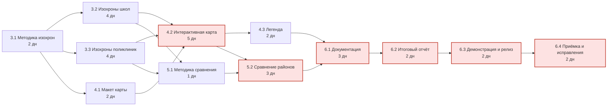
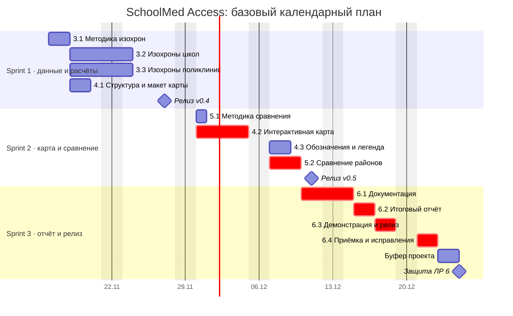

# Календарный план и ресурсы

**Базовый план, версия 1.0, утверждён 15.11.2026.** Изменения после утверждения — только через запрос на изменение.

## 1. Доступное время

- Период разработки: **16.11.2026 — 26.12.2026**, 30 рабочих дней (6 недель).
- Команда: 3 человека по 6 ч/нед на продукт + 0,5 ч/нед на управление.
- Ёмкость: 3 × 6 ч × 6 нед = **108 ч** на продукт и управление; продукт — 99 ч (без 9 ч управления).
- Жёсткие вехи: ЛР 4 — 12.12.2026, ЛР 5 — 19.12.2026, ЛР 6 (защита) — 26.12.2026.

## 2. Сетевой график

Длительности переведены из часов в рабочие дни из расчёта 6 ч/нед на человека и 3 ч/день на команду.

Отсчёт ведём в рабочих днях от начала периода: день 0 — 16.11.2026.

| Работа | Длит., дн | Предшественники | ES | EF | LS | LF | Резерв |
|---|---|---|---|---|---|---|---|
| 3.1 Методика изохрон | 2 | — | 0 | 2 | 4 | 6 | 4 |
| 3.2 Изохроны школ | 4 | 3.1 | 2 | 6 | 6 | 10 | 4 |
| 3.3 Изохроны поликлиник | 4 | 3.1 | 2 | 6 | 6 | 10 | 4 |
| 4.1 Макет карты | 2 | 3.1 | 2 | 4 | 8 | 10 | 6 |
| 5.1 Методика сравнения | 1 | 3.2, 3.3 | 10 | 11 | 14 | 15 | 4 |
| 4.2 Интерактивная карта | 5 | 3.2, 3.3, 4.1 | 10 | 15 | 10 | 15 | **0** |
| 4.3 Легенда | 2 | 4.2 | 15 | 17 | 16 | 18 | 1 |
| 5.2 Сравнение районов | 3 | 5.1, 4.2 | 15 | 18 | 15 | 18 | **0** |
| 6.1 Документация | 3 | 4.3, 5.2 | 18 | 21 | 18 | 21 | **0** |
| 6.2 Итоговый отчёт | 2 | 6.1 | 21 | 23 | 21 | 23 | **0** |
| 6.3 Демонстрация и релиз | 2 | 6.2 | 23 | 25 | 23 | 25 | **0** |
| 6.4 Приёмка и исправления | 2 | 6.3 | 25 | 27 | 25 | 27 | **0** |

**Критический путь:** 4.2 → 5.2 → 6.1 → 6.2 → 6.3 → 6.4. Длина — **27 рабочих дней** из 30 доступных. Работы 3.1–3.3 лежат в Sprint 1 и имеют резерв 4 дня, потому что карта стартует со Sprint 2.

**Решения по срокам.** План укладывается в доступное время: 27 дней работ + 2 дня буфера = 29 из 30. Работы 3.x и 4.1 заканчиваются в Sprint 1 с резервом, поэтому перенос данных не критичен, а вот 4.2 и 5.2 — критические: их задержка сразу сдвигает отчёт и защиту.

## 3. Диаграмма Ганта

**Буфер проекта — 2 рабочих дня**, стоит в конце перед финальной вехой и не раздаётся по задачам. Величина взята из разницы между уровнем 85 % и ожидаемой трудоёмкостью: (96,1 − 91,1) ч ≈ 5 ч, что при командной производительности 3,6 ч/день даёт 1,4 дня, округлённо 2 дня. Буфер расходуется только по решению менеджера проекта.

## 4. Ресурсы

Ёмкость: 6 ч/нед на человека = **12 ч за двухнедельный спринт**, 36 ч на команду, из них 6 ч — управление.

### Матрица загрузки до выравнивания

| Участник | Sprint 1 | Sprint 2 | Sprint 3 |
|---|---|---|---|
| Тимур (аналитик) | **17,9 (149 %)** | 9,3 (78 %) | — |
| Нияз (техлид) | **18,0 (150 %)** | **14,8 (123 %)** | — |
| Виктория (PM) | 6,3 (53 %) | **15,7 (131 %)** | **24,3 (203 %)** |
| **Команда** | 42,2 из 36 (117 %) | 39,8 из 36 (111 %) | 24,3 из 36 (68 %) |

Причина перегрузки — распределение «по ролям»: вся аналитика досталась Тимуру, карта — Ниязу, а отчёт и коммуникации — Виктории.

### Решения по выравниванию

1. Расчёты изохрон (3.2 и 3.3) разделены между Тимуром и Викторией: оба пакета — независимые расчёты по одной методике, Виктории достаточно 1 ч брифинга.
2. Часть работ по карте (4.2) передана Тимуру после завершения расчётов; у него освобождается время в Sprint 2.
3. Документация (6.1) разделена между Ниязом и Викторией, отчёт (6.2) забирает Тимур после 5.2.

### Матрица загрузки после выравнивания

| Участник | Sprint 1 | Sprint 2 | Sprint 3 | Всего |
|---|---|---|---|---|
| Тимур | 11,9 (99 %) | 11,8 (98 %) | 8,3 (69 %) | 32,0 |
| Нияз | 11,6 (97 %) | 11,0 (92 %) | 8,5 (71 %) | 31,1 |
| Виктория | 12,0 (100 %) | 10,8 (90 %) | 8,8 (73 %) | 31,6 |
| **Команда** | 35,5 из 36 (99 %) | 33,6 из 36 (93 %) | 25,6 из 36 (71 %) | **94,7 из 108 (88 %)** |

Свободные 13 часов — запас на неточность оценок; новыми задачами его не заполняем.

## 5. Релизный план

| Спринт | Даты | Цель спринта | Истории (SP) | Пакеты WBS | Релиз |
|---|---|---|---|---|---|
| Sprint 1 | 16.11–27.11 | Данные и методика готовы: изохроны школ и поликлиник рассчитаны | US-03 (8), US-06 (2) | 3.1, 3.2, 3.3, 4.1 | v0.4-data |
| Sprint 2 | 30.11–11.12 | Заказчик видит интерактивную карту и сравнение районов | US-04 (5), US-07 (3) | 4.2, 4.3, 5.1, 5.2 | v0.5-map |
| Sprint 3 | 14.12–25.12 | Отчёт готов, продукт принят, защита проведена | US-05 (5), приёмка | 6.1, 6.2, 6.3, 6.4 | v0.6-mvp |

**Гипотеза скорости:** 23 SP за три спринта ≈ **8 SP за спринт**. Sprint 1 загружен на 10 SP (выше гипотезы), поэтому заранее решено: если по итогам Sprint 1 закроется меньше 8 SP, история US-06 «частные клиники отдельным слоем» переносится в Sprint 3 — она не блокирует карту и отчёт.

**Проверка по ёмкости:** план 94,7 ч из 108 ч (88 %), остальное — резерв на неточность оценок и учебную нагрузку.

## 6. Спринт 1

**Цель спринта:** «Данные проверены, методика зафиксирована, изохроны школ и поликлиник рассчитаны — есть что показать на карте».

| Задача | Пакет | Исполнитель | Оценка | Критерий готовности |
|---|---|---|---|---|
| Методика расчёта изохрон | 3.1 | Тимур | 5,2 ч | `docs/methodology.md` с выбором способа передвижения и параметрами |
| Расчёт изохрон школ | 3.2 | Тимур | 12,7 ч | `data/isochrones/schools.geojson`, проверено на одном районе |
| Расчёт изохрон поликлиник | 3.3 | Виктория | 12,7 ч | `data/isochrones/clinics.geojson`, проверено на одном районе |
| Структура и макет карты | 4.1 | Нияз | 5,3 ч | описание слоёв и элементов управления в задаче |
| Спайк: проверка пешеходной сети | — | Тимур | лимит 4 ч | вывод в задаче: годится ли сеть OSM для изохрон |

После Sprint 1 — релиз v0.4-data и статус-отчёт спонсору.
