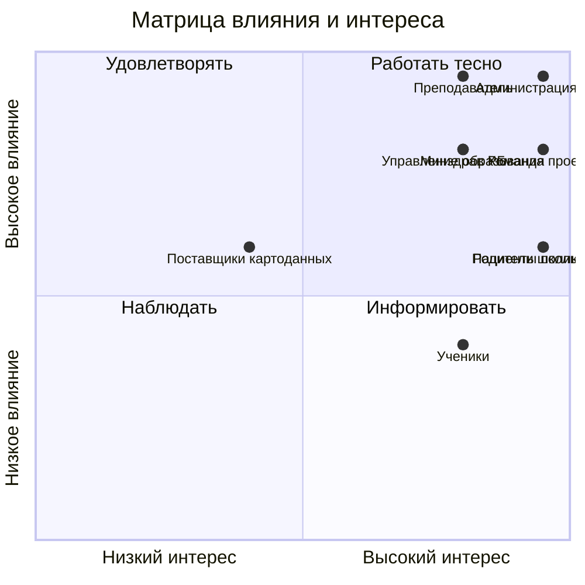

# Стейкхолдеры, матрица влияния и интереса, RACI

<!-- TODO: шаг 4 задания ЛР 1. Минимум 8 стейкхолдеров и 8 работ в RACI. -->

## Реестр
| **Стейкхолдер** | **Роль** | **Что ожидает** | **Влияние (1–5)** | **Интерес (1–5)** | **Как работаем** |
|---|---|---|---:|---:|---|
| Администрация Уфы | Заказчик | Информация о районах с низкой доступностью учреждений | 5 | 4 | Показывать результаты анализа |
| Управление образования Уфы | Заинтересованная сторона | Данные о расположении школ и их доступности | 4 | 4 | Использовать открытые данные |
| Министерство здравоохранения РБ | Заинтересованная сторона | Информация о доступности поликлиник | 4 | 4 | Изучать открытые данные |
| Родители школьников | Пользователи | Понимание, сколько времени занимает дорога до школы | 3 | 5 | Учитывать их потребности |
| Ученики | Пользователи | Удобный путь до школы | 2 | 4 | Учитывать доступность пеших маршрутов |
| Пациенты поликлиник | Пользователи | Возможность быстро добраться до поликлиники | 3 | 5 | Учитывать при анализе районов |
| Команда проекта | Исполнители | Понятные задачи и доступные данные | 4 | 5 | Распределять задачи и проводить встречи |
| Преподаватель | Куратор | Выполнение требований лабораторной работы | 5 | 4 | Показывать результаты на контрольных точках |
| Поставщики картографических данных | Поставщики данных | Правильное использование данных | 3 | 2 | Проверять условия использования данных |

## Матрица влияния и интереса
Координаты по осям от 0 до 1. Замените примеры своими стейкхолдерами.

## RACI
В каждой строке ровно одна буква A.

| Работа | Менеджер проекта | Аналитик | Тех. организатор | Заказчик |
| Устав проекта | A | R | C | I |
| Реестр стейкхолдеров | A | R | I | C |
| Сбор данных о школах и поликлиниках | I | A | R | C |
| Проверка качества данных | C | A | R | I |
| Подготовка карты города | I | C | A | I |
| Построение изохрон | C | A | R | I |
| Анализ доступности районов | I | A | R | C |
| Подготовка итогового отчёта | A | R | C | I |
| Тестирование карты | C | A | R | I |
| Утверждение результатов | R | C | I | A |

## Интервью с заказчиком
Протокол: [docs/meetings/](meetings/)
