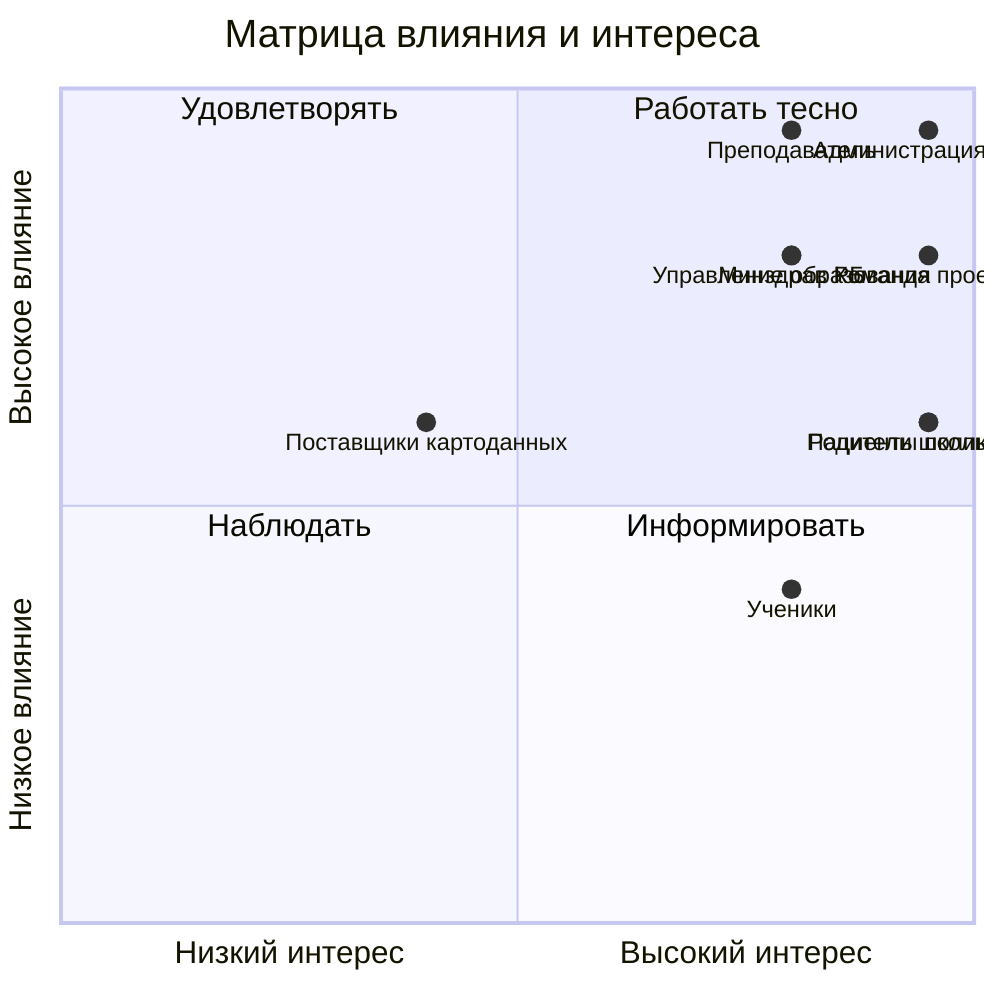

# Стейкхолдеры, матрица влияния и интереса, RACI

Версия 1.0 · Дата: 31.10.2026 · Авторы: Тимур Зайнуллин, Нияз Бадриев · Статус: на согласовании

Документ фиксирует, кто влияет на проект SchoolMed Access и на кого влияет он сам, а также распределяет ответственность за работы инициации.

## Реестр
Влияние и интерес оцениваются по шкале от 1 (минимум) до 5 (максимум).

| **Стейкхолдер** | **Роль** | **Что ожидает** | **Влияние (1–5)** | **Интерес (1–5)** | **Как работаем** |
|---|---|---:|---:|---:|---|
| Администрация Уфы | Заказчик | Информация о районах с низкой доступностью учреждений | 5 | 4 | Показывать результаты анализа |
| Управление образования Уфы | Заинтересованная сторона | Данные о расположении школ и их доступности | 4 | 4 | Использовать открытые данные |
| Министерство здравоохранения РБ | Заинтересованная сторона | Информация о доступности поликлиник | 4 | 4 | Изучать открытые данные |
| Родители школьников | Пользователи | Понимание, сколько времени занимает дорога до школы | 3 | 5 | Учитывать их потребности |
| Ученики | Пользователи | Удобный путь до школы | 2 | 4 | Учитывать доступность пеших маршрутов |
| Пациенты поликлиник | Пользователи | Возможность быстро добраться до поликлиники | 3 | 5 | Учитывать при анализе районов |
| Команда проекта | Исполнители | Понятные задачи и доступные данные | 4 | 5 | Распределять задачи и проводить встречи |
| Преподаватель | Куратор | Выполнение требований лабораторной работы | 5 | 4 | Показывать результаты на контрольных точках |
| Поставщики картографических данных | Поставщики данных | Правильное использование данных | 3 | 2 | Проверять условия использования данных |

## Матрица влияния и интереса
Матрица построена по оценкам из реестра: ось X — интерес, ось Y — влияние, координаты по осям от 0 до 1.

## RACI
Роли в таблице: менеджер проекта — Нияз Бадриев, аналитик — Виктория Исаева, технический организатор — Виктория Исаева, заказчик — преподаватель в роли спонсора. В каждой работе ровно одно ответственное лицо: A отвечает за результат, R выполняет работу, C консультирует, I получает информацию.

| Работа | Менеджер проекта | Аналитик | Тех. организатор | Заказчик |
|---|---|---|---|---|
| Устав проекта | A | R | C | I |
| Реестр стейкхолдеров | A | R | I | C |
| Сбор данных о школах и поликлиниках | I | A | R | C |
| Проверка качества данных | C | A | R | I |
| Подготовка карты города | I | C | A | I |
| Построение изохрон | C | A | R | I |
| Анализ доступности районов | I | A | R | C |
| Подготовка итогового отчёта | A | R | C | I |
| Тестирование карты | C | A | R | I |
| Утверждение результатов | R | C | I | A |

## Стратегия работы по квадрантам
Квадрант задаёт режим коммуникации: чем выше влияние и интерес стороны, тем плотнее работа с ней.

| Квадрант | Стейкхолдеры проекта (влияние / интерес) | Как работаем |
|---|---|---|
| Высокое влияние — высокий интерес: работать тесно | Администрация Уфы (5/4), Управление образования Уфы (4/4), Министерство здравоохранения РБ (4/4), Команда проекта (4/5), Преподаватель (5/4), Родители школьников (3/5), Пациенты поликлиник (3/5) | Показываем результаты на каждой контрольной точке, согласуем выводы до публикации, собираем обратную связь и учитываем её в анализе районов |
| Высокое влияние — низкий интерес: удовлетворять | Поставщики картографических данных (3/2) | Держим в курсе изменений в использовании данных, оперативно согласуем условия лицензий и указание авторства |
| Низкое влияние — высокий интерес: информировать | Ученики (2/4) | Публикуем карту и краткие выводы о пешей доступности школ, обратную связь собираем через родителей и школу |
| Низкое влияние — низкий интерес: наблюдать | В реестре таких сторон нет | Отдельной работы не планируем. Квадрант оставляем для новых участников: смежные управления и подрядчики, которые появятся в ЛР 2–4 |

Положение на матрице задано координатами из раздела выше. Стороны с оценкой влияния 3 из 5 лежат выше середины оси, поэтому отнесены к квадранту высокого влияния: для родителей и пациентов плотная работа означает прежде всего сбор обратной связи и проверку результатов на них.

## Интервью с заказчиком
Интервью с заказчиком проведено 31.10.2026. Вопросы построены вокруг ключевого вопроса проекта из [бизнес-обоснования](business-case.md), протокол и ответы зафиксированы в файле [протокол интервью с заказчиком](meetings/2026-10-31-interview-customer.md).

- Ответы заказчика уточнили ожидания в реестре: администрации нужна информация о районах с низкой доступностью учреждений, а не список объектов.
- Матрица влияния и интереса и RACI опираются на эти ответы; после следующих интервью оценки пересматриваем на вехах.
