# Иерархическая структура работ (WBS)

WBS проекта «Доступность школ и поликлиник в Уфе» описывает результаты проекта и работы, необходимые для их получения.

Структура включает три уровня:
1. Проект.
2. Эпики E1–E6.
3. Пакеты работ.

Пакеты работ имеют одного ответственного, проверяемый результат и оценку трудозатрат от 8 до 80 часов.

## Диаграмма

```mermaid
flowchart TD
    P["0. Доступность школ и поликлиник в Уфе"]

    P --> E1["1. Данные · E1"]
    P --> E2["2. Платформа и качество · E2"]
    P --> E3["3. Аналитика · E3"]
    P --> E4["4. Пользовательский интерфейс · E4"]
    P --> E5["5. Аналитика районов · E5"]
    P --> E6["6. Отчётность · E6"]

    E1 --> W11["1.1 Реестр источников"]
    E1 --> W12["1.2 Данные о школах"]
    E1 --> W13["1.3 Данные о поликлиниках"]

    E2 --> W21["2.1 Проверка полноты данных"]
    E2 --> W22["2.2 Проверка координат"]
    E2 --> W23["2.3 Подготовленные геоданные"]

    E3 --> W31["3.1 Методика расчёта изохрон"]
    E3 --> W32["3.2 Изохроны школ"]
    E3 --> W33["3.3 Изохроны поликлиник"]

    E4 --> W41["4.1 Структура и макет карты"]
    E4 --> W42["4.2 Интерактивная карта"]
    E4 --> W43["4.3 Обозначения и легенда"]

    E5 --> W51["5.1 Методика сравнения районов"]
    E5 --> W52["5.2 Сравнение доступности"]
    E5 --> W53["5.3 Выявление зон низкой доступности"]

    E6 --> W61["6.1 Документация проекта"]
    E6 --> W62["6.2 Итоговый аналитический отчёт"]
    E6 --> W63["6.3 Демонстрация и релиз"]
```

## Словарь WBS

Для каждого пакета работ указаны результат, критерий готовности, ответственный и предварительная оценка трудозатрат.

| Код | Пакет работ | Результат | Критерий готовности | Ответственный | Оценка, ч | Эпик / Issues |
|---|---|---|---|---|---:|---|
| 1.1 | Реестр источников данных | `data/sources.md` | Для источников школ и поликлиник указаны ссылки, даты получения и условия использования | @BariNiaz | 12 | E1 |
| 1.2 | Сбор данных о школах | `data/schools.csv` | Собраны названия и координаты школ Уфы, для записей указаны источники | @pippopbib | 16 | E1, US-01 |
| 1.3 | Сбор данных о поликлиниках | `data/clinics.csv` | Собраны названия и координаты поликлиник Уфы, для записей указаны источники | @pippopbib | 16 | E1, US-01 |
| 2.1 | Проверка полноты данных | `docs/data-quality.md` | Проверены пустые значения, дубликаты и наличие обязательных полей | @pippopbib | 12 | E2, US-02 |
| 2.2 | Проверка координат | Проверенные CSV-файлы | Координаты проверены на карте, ошибки и подозрительные точки отмечены | @pippopbib | 16 | E2, US-02 |
| 2.3 | Подготовка геоданных | `data/processed/` | Данные очищены и приведены к единому пространственному формату | @Intheclouds122 | 16 | E2 |
| 3.1 | Методика расчёта изохрон | `docs/methodology.md` | Описаны выбранный способ передвижения, параметры и метод расчёта зон доступности | @pippopbib | 8 | E3 |
| 3.2 | Расчёт изохрон школ | `data/isochrones/schools.geojson` | Рассчитаны и сохранены зоны доступности школ | @pippopbib | 24 | E3, US-03 |
| 3.3 | Расчёт изохрон поликлиник | `data/isochrones/clinics.geojson` | Рассчитаны и сохранены зоны доступности поликлиник | @pippopbib | 24 | E3, US-03 |
| 4.1 | Структура и макет карты | Описание структуры карты | Определены слои, элементы управления и способ отображения учреждений | @BariNiaz | 12 | E4 |
| 4.2 | Интерактивная карта | Рабочий прототип карты | На карте отображаются школы, поликлиники и рассчитанные изохроны | @pippopbib | 40 | E4, US-04 |
| 4.3 | Обозначения и легенда | Легенда карты | Слои различимы, обозначения понятны, названия учреждений доступны пользователю | @BariNiaz | 12 | E4 |
| 5.1 | Методика сравнения районов | `docs/district-methodology.md` | Определены показатели и правила сравнения доступности районов | @Intheclouds122 | 8 | E5 |
| 5.2 | Сравнение доступности районов | `data/district-comparison.csv` | Подготовлено сравнение минимум трёх районов Уфы | @Intheclouds122 | 24 | E5, US-05 |
| 5.3 | Выявление зон низкой доступности | `docs/low-access-areas.md` | Выявлены территории с низкой доступностью и приведены обоснованные выводы | @pippopbib | 16 | E5, US-05 |
| 6.1 | Документация проекта | Файлы в `docs/` | Требования, WBS, методика и источники данных оформлены и согласованы внутри команды | @pippopbib | 16 | E6 |
| 6.2 | Итоговый аналитический отчёт | `docs/final-report.md` | Описаны методика, использованные данные, результаты и ограничения исследования | @pippopbib | 16 | E6 |
| 6.3 | Демонстрация и релиз | Демонстрация, релиз проекта | Подготовлена демонстрация карты, результаты представлены, создан итоговый релиз | @pippopbib | 16 | E6 |

## Примечания

1. Оценки трудозатрат предварительные и могут изменяться после согласования с командой.
2. Ответственные назначены по предварительному распределению ролей из эпиков E1–E6.
3. Пакеты работ нижнего уровня являются проверяемыми результатами проекта.
4. Сравнение районов и выявление зон низкой доступности относятся к следующей версии продукта, поскольку в MVP входят сбор и проверка данных, расчёт изохрон и отображение карты.
5. Номера GitHub Issues для пакетов работ добавляются после создания соответствующих задач. US-01–US-05 обозначают пользовательские истории.
